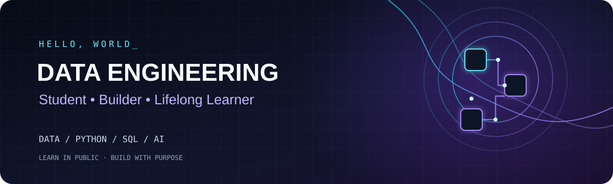

[README.md](https://github.com/user-attachments/files/33699508/README.md)
<!--
  GitHub Profile README
  1. Create a public repository whose name exactly matches your GitHub username.
  2. Replace every placeholder such as YOUR-GITHUB-USERNAME and YOUR-LINKEDIN-URL.
  3. Upload this README.md and the assets/profile-banner.svg file.
  4. Keep only the technologies and links that accurately represent you.
-->

  
  

---

## `whoami` — Hello, I'm Shabariraj Rajendran 👋

I'm currently pursuing a **Bachelor of Computer Science (Data Engineering)** at **Universiti Teknologi Malaysia (UTM), Johor Bahru**.

I'm building my foundations in programming, data, and modern technology by learning consistently, experimenting with ideas, and documenting what I create. This profile is my public learning log: a place to share projects, practical experiments, lessons learned, and progress over time.

- 🎓 **Currently studying:** Computer Science (Data Engineering) at UTM
- 🐍 **Building foundations in:** Python and SQL
- 🧱 **Exploring:** Data engineering concepts and data workflows
- 🤖 **Interested in:** Artificial intelligence, Generative AI, and Agentic AI
- ☁️ **Learning about:** Cloud computing and cybersecurity awareness
- 📚 **Approach:** Learn it, build it, document it, improve it

> I’m not here to claim I know everything. I’m here to keep learning, build useful things, and show the process honestly.

## `focus --current` — What I'm focusing on

| Area | Current direction |
|---|---|
| Data Engineering | Learning how data is collected, transformed, stored, and used |
| Programming | Practising Python and SQL through small exercises and projects |
| Artificial Intelligence | Exploring responsible AI, Generative AI, and Agentic AI |
| Cloud & Security | Developing foundational awareness of cloud computing and cybersecurity |
| Portfolio | Turning learning into documented, reproducible projects |

## `tech-stack` — Tools & technologies

These are learning areas and tools I'm building familiarity with, not a claim of expert-level proficiency.

**Areas of interest**

`Data Engineering` · `SQL` · `Python` · `Artificial Intelligence` · `Generative AI` · `Agentic AI` · `Cloud Computing` · `Cybersecurity Awareness`

*Add or remove icons as your experience changes. Only list tools you have actually used.*

## `projects` — Things I'm building

I use projects to turn concepts into practical experience. As I publish work, this section will become a showcase of what I've built and what I've learned.

- **Data Engineering Projects** — small projects exploring data cleaning, transformation, storage, and analysis.
- **Python & SQL Practice** — exercises and mini-projects that strengthen programming and querying fundamentals.
- **AI Experiments** — carefully documented experiments with Generative AI, prompting, and workflow ideas.

**Coming next:** Replace these examples with links to your real repositories. For each project, explain the problem, tools used, what you built, and what you learned. Do not leave a project listed here unless you are actively working on it or have published it.

## `certifications` — Continuous learning

Completed six Malaysian government / Rakyat Digital certificates covering:

- AI Nation 2030
- AI Safety
- Cloud Computing
- Cybersecurity
- Generative AI
- Agentic AI

These certificates represent learning and foundational exposure. I'll continue strengthening that knowledge through practical projects and hands-on experience.

## `github-stats` — Activity & progress

These cards are provided by a third-party service and may occasionally be unavailable or rate-limited. Language statistics reflect code in repositories, not overall ability.

## `connect` — Let's connect

I'm happy to connect with students, developers, and people interested in data, AI, and technology. If you're also learning, building, or sharing useful resources, let's connect.

---

**Learning in public. Building with purpose. Improving one project at a time.**

Thanks for visiting my corner of GitHub ✨

- 🌱 I’m currently learning ...
- 👯 I’m looking to collaborate on ...
- 🤔 I’m looking for help with ...
- 💬 Ask me about ...
- 📫 How to reach me: ...
- 😄 Pronouns: ...
- ⚡ Fun fact: ...
-->
